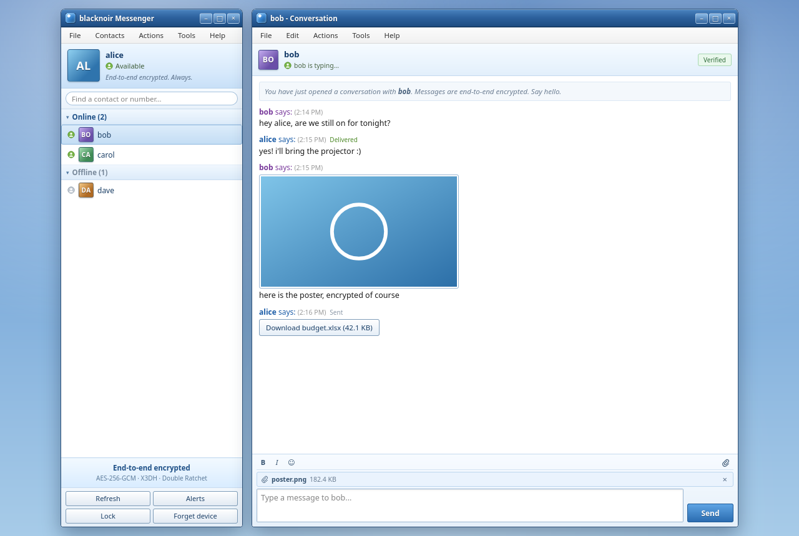

# blacknoir

A small, self-hostable end-to-end encrypted messenger. Keys are generated in the
browser and never leave it. The relay stores and forwards opaque ciphertext
envelopes only.

Built for the people who need it most: journalists and sources, organizers,
caseworkers, clinics, and anyone who should not have to trust a chat provider with
the contents of their conversations.



```
  Browser A                      Relay (Node)                     Browser B
  ---------                      -----------                     ---------
  Ed25519 identity               no private keys                 Ed25519 identity
  X25519 keys                    no plaintext                    X25519 keys
  X3DH handshake          <--- ciphertext envelopes --->          X3DH handshake
  Double Ratchet                 offline queue                   Double Ratchet
  AES-256-GCM                    encrypted blobs                 AES-256-GCM
```

## Features

- **End-to-end text chat** with X3DH and the Double Ratchet over AES-256-GCM.
- **Safety numbers** to verify a contact's identity and catch a malicious relay.
- **Encrypted file and image sharing**: files are encrypted in the browser, stored
  as opaque blobs, and the key travels inside the ratchet.
- **Delivery status, typing indicators and presence** over the WebSocket.
- **Device passphrase**: optionally encrypt keys, sessions and history at rest with
  Argon2id + AES-256-GCM.
- **Installable PWA** with offline shell caching, desktop notifications, and an
  offline outbox that retries when the connection returns.
- **MSN Messenger 2009-inspired interface**, because privacy tools can be pleasant.

## Cryptographic details

| Purpose | Primitive |
| --- | --- |
| Identity signing / auth | Ed25519 |
| Identity and ratchet keys | X25519 |
| Handshake | X3DH (4-DH variant, one-time prekey optional) |
| Root/chain KDF | HKDF-SHA256 |
| Chain step | HMAC-SHA256 |
| Message encryption | AES-256-GCM (12-byte nonce, 128-bit tag) |
| Message key derivation | HKDF-SHA256 to 32-byte key + 12-byte nonce |
| Safety numbers | SHA-256 over the sorted identity keys, 60 decimal digits |
| Attachments | Random AES-256-GCM key per file; key sent inside the ratchet |
| Local vault | Argon2id (19 MiB, t=2, p=1) + AES-256-GCM |

Additional authenticated data (AAD) binds the X3DH transcript and the ratchet header
(`dh`, `pn`, `n`) to every ciphertext, so tampering with either fails authentication.

The protocol is implemented in `src/crypto/` with no crypto dependencies beyond
`@noble/curves` for the curves, `@noble/hashes` for Argon2id/SHA-256, and
`@noble/ciphers` for the synchronous local vault. AES-GCM, HKDF, and HMAC use
WebCrypto, which is the same API in browsers and Node.

## Quick start

```bash
npm install
npm run dev
```

Open <http://localhost:5173>, create an identity, then open a second browser
profile (or incognito window) and create another. Pick each other and chat.

Production:

```bash
npm run build
npm start          # serves dist/ and the relay on :8787
```

Set `PORT` to change the port. The relay persists users, messages, and blob metadata
to `data/store.json`; encrypted blobs live in `data/blobs/`. Mount that directory if
you deploy in a container.

## Usage

1. Choose a username. The client generates an Ed25519 key, an X25519 key, a signed
   prekey, and 20 one-time prekeys locally.
2. The username and **public** prekeys are registered with the relay. Private keys
   stay in this browser's local storage.
3. Select a person, send a message. The first message performs X3DH; later messages
   are pure Double Ratchet traffic.
4. Click **Verify** in the conversation header to compare safety numbers with your
   contact. Mark them verified once you have compared. If their identity key ever
   changes, the badge turns red.
5. Use the paperclip to send an encrypted image or file (max 8 MB).
6. **Set passphrase** in the contact list footer to encrypt keys, sessions, history,
   and the offline outbox at rest. **Lock** requires the passphrase on next load.
7. **Alerts** enables desktop notifications. Notifications deliberately never include
   message content.
8. Messages are acknowledged and deleted from the relay after decryption. Chat
   history lives only on the device.

## Project layout

```
src/crypto/    X3DH, Double Ratchet, AEAD, safety numbers, vault, key generation
src/server/    Express API + WebSocket relay, JSON persistence, encrypted blobs
src/client/    Vanilla TypeScript single-page client (Vite)
public/        PWA manifest, service worker, icons
tests/         Vitest suite for the protocol and vault
index.html     Client entry
```

## Tests

```bash
npm test
npm run typecheck
npm run build
```

The suite covers X3DH agreement, forged prekey rejection, bidirectional ratcheting,
out-of-order delivery, skipped keys across a DH ratchet, tampered ciphertext and
headers, session serialization, safety-number symmetry, and vault sealing.

## Security model

**Protected against**

- A malicious or compromised relay reading message contents or attachments.
- Passive observers of stored data (server stores ciphertext only).
- Forgery of a contact's signed prekey.
- A relay substituting identity keys, once safety numbers are verified out of band.
- Ciphertext or header tampering (AEAD).
- Message-key reuse (each message has a unique key).
- Retroactive decryption after a ratchet step (forward secrecy).
- Replay of an already-processed message (fails authentication and is dropped).
- Theft of the device's local storage when a passphrase vault is enabled.

**Not protected against**

- A compromised device while unlocked. The unlocked keys and history are in memory.
- Metadata: the relay sees usernames, who messages whom, timestamps, message sizes,
  and attachment sizes. There is no padding, sealed sender, or traffic-analysis
  resistance.
- Notification content is hidden, but notification metadata (that a message arrived
  from a contact) is visible to the operating system.
- Multi-device use. One identity equals one browser profile; there is no device
  linking or key transparency.
- Simultaneous first messages. If both people message each other before any reply,
  two sessions can be created. This is a known limitation of this MVP.
- Group conversations, voice, and video.
- Denial of service. There is no rate limiting, spam control, or registration
  gating. Run it for a trusted group or add limits before exposing it widely.
- Side channels in the JavaScript runtime. This is a portable implementation, not a
  constant-time native one.
- Passphrase recovery. If you forget it, the local data is unrecoverable.

This code has not been audited. Do not rely on it for life-critical situations
without an independent review.

## Hardening checklist for a public deployment

- Terminate TLS and forward only HTTPS/WSS.
- Back up and restrict access to `data/`.
- Add rate limiting and registration controls.
- Add blob retention and cleanup (encrypted blobs currently stay on disk).
- Rotate signed prekeys and replenish one-time prekeys.
- Add multi-device session management.
- Get an external security review.

## License

MIT
